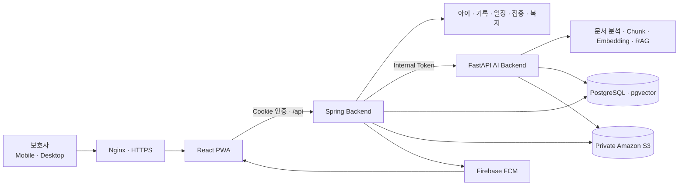
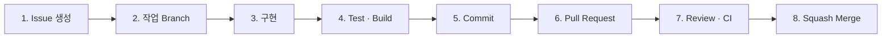

<div align="center">


# 💗 도담 DODAM

## 🌱 오늘의 기록이 내일의 돌봄이 됩니다

**아이의 검진 결과를 읽고, 필요한 돌봄으로**

증상 메모 한 줄에서 시작해 검진 결과를 이해하고,<br />
우리 아이에게 맞는 지원까지 도담이 그 사이를 이어 드립니다.

[](https://dodam-ieum.duckdns.org/home)
[](https://github.com/ieum-connect)
[](https://github.com/ieum-connect/Dodam_frontend)
[](https://github.com/ieum-connect/Dodam_backend)
[](https://github.com/ieum-connect/Dodam_AI_backend)

</div>

---

## 💡 WHY DODAM?

### 아이를 위한 정보는 많지만, 우리 아이에게 필요한 정보는 찾기 어렵습니다

도담은 흩어진 건강 기록과 검진 문서를 한곳에 모아 **이해하고, 비교하고, 챙기고, 기록하는** 영유아 돌봄 관리 서비스입니다. 보호자가 매번 어려운 의료 용어를 검색하거나 여러 기관의 정보를 따로 찾아보지 않아도, 기록에서 다음 돌봄까지 하나의 흐름으로 연결합니다.

| `50.2%` | `18.7%` | `35.0%` |
|:---:|:---:|:---:|
| 육아 정책·서비스를 이용하지 않는 가장 큰 이유는 **“잘 몰라서”** | 영유아 건강검진 결과 중 **추가 관리가 필요한 비율** | 부모가 선호하는 교육 방식은 **1:1 맞춤 상담** |
| 부산광역시 2025 육아정책 조사 | 국민건강보험공단 2024 건강검진 통계연보 | 교육부·육아정책연구소 2024 전국보육실태조사 |

> 받을 수 있는 지원이 있어도 어떤 정책이 있는지 찾기 어렵고, 검진 결과가 어떤 의미인지 이해하기 어렵습니다. 도담은 기록과 문서를 바탕으로 우리 아이에게 필요한 정보와 돌봄을 연결합니다.

---

## 🧭 HOW TO USE DODAM?

### 검진 설명부터 맞춤 복지까지, 도담 하나로 챙깁니다

| STEP | 기능 | 도담이 돕는 일 |
|:---:|---|---|
| `01` | **📝 건강 메모 · 일정 · 성장 기록** | 증상·식사·수면과 키·몸무게를 기록하고, 가족이 일정과 기록을 함께 확인합니다. 흩어진 정보를 아이별 타임라인에서 한눈에 볼 수 있습니다. |
| `02` | **💉 예방접종 관리** | 만 12세까지 남은 접종을 알려 주고 캘린더에 담습니다. 이미 맞은 접종은 공식 사이트와 연동해 확인할 수 있어 다음 접종 시점을 놓치지 않습니다. |
| `03` | **🏥 병원 기록 · 문서 보관 · 복약 알림** | 결과서·진단서·처방전을 방문 기록과 연결하고, 처방전에 맞춰 복약 일정을 관리합니다. 서랍 속 종이를 다시 찾을 필요가 없습니다. |
| `04` | **🤖 AI 도담** | 올린 건강 문서를 쉬운 말로 풀고 이전 검진 결과와 비교합니다. 문서 근거와 출처를 함께 보여 주어 검색하지 않아도 핵심을 이해할 수 있습니다. |
| `05` | **🎁 맞춤 복지 추천** | 아이의 연령·지역·가족 프로필을 바탕으로 관련 복지 사업과 신청 조건·준비 서류를 안내해 몰라서 놓치던 지원을 찾도록 돕습니다. |

<div align="center">

**📝 건강 기록**　→　**🤖 AI 해석·비교**　→　**🎁 맞춤 복지**

</div>

<details>
<summary><b>📖 리플렛으로 도담 한눈에 보기</b></summary>

<br />


<br /><br />


</details>

---

## 👨‍👩‍👧‍👦 TEAM IEUM

<div align="center">

**기록과 돌봄 사이를 기술로 잇는 팀, 이음입니다.**

</div>

<table align="center">
  <tr>
    <td align="center" width="33%">
      <a href="https://github.com/yendlessse">
        <br />
        <b>유한세</b>
      </a><br />
      <sub>@yendlessse</sub>
    </td>
    <td align="center" width="33%">
      <a href="https://github.com/MadVedi">
        <br />
        <b>정재헌</b>
      </a><br />
      <sub>@MadVedi</sub>
    </td>
    <td align="center" width="33%">
      <a href="https://github.com/choihwanwoo">
        <br />
        <b>최환우</b>
      </a><br />
      <sub>@choihwanwoo</sub>
    </td>
  </tr>
</table>

---

## 🛠️ TECH STACK

### 🎨 Frontend


### ⚙️ Spring Backend


### 🤖 AI Backend


### ☁️ Infrastructure


---

## 🏗️ SERVICE ARCHITECTURE



1. Frontend는 Spring Backend를 단일 API 진입점으로 사용합니다.
2. Spring Backend는 사용자 인증, 가족 관계와 아이별 접근 권한을 우선 확인합니다.
3. 의료 문서 분석과 AI 질의가 필요할 때만 내부 토큰으로 AI Backend를 호출합니다.
4. 원본 문서는 Private S3에, 서비스 데이터와 임베딩은 PostgreSQL·pgvector에 저장합니다.
5. Backend·AI·Database는 내부 Docker Network에서 통신하고 외부에는 Nginx HTTPS만 공개합니다.

---

## 🗂️ REPOSITORY

| Repository | 담당 영역 | 핵심 구성 |
|---|---|---|
| 🎨 [Dodam_frontend](https://github.com/ieum-connect/Dodam_frontend) | 모바일 중심 UI, PWA, Push 수신 | React · Vite · Firebase FCM · Nginx |
| ⚙️ [Dodam_backend](https://github.com/ieum-connect/Dodam_backend) | 인증·권한, 아이·기록·일정·접종·복지, AI 중계 | Java 17 · Spring Boot 3.3 · JPA · Flyway |
| 🤖 [Dodam_AI_backend](https://github.com/ieum-connect/Dodam_AI_backend) | 의료 문서 처리, 임베딩·검색, RAG 답변과 안전 정책 | Python 3.12+ · FastAPI · SQLAlchemy · pgvector |
| ☁️ [Dodam_infra](https://github.com/ieum-connect/Dodam_infra) | 배포·프록시·데이터베이스·백업·운영 | AWS · Docker Compose · Nginx · GitHub Actions |
| 🏠 [.github](https://github.com/ieum-connect/.github) | 조직 프로필과 공통 프로젝트 소개 | GitHub Organization Profile |

<details open>
<summary><b>📂 저장소별 구조 자세히 보기</b></summary>

```text
ieum-connect/
├── Dodam_frontend/
│   ├── src/                       # React 화면, 상태, API Client, Domain UI
│   ├── public/                    # PWA Manifest, Service Worker, App Icon
│   ├── docs/                      # 화면·기능·검증 문서
│   └── .github/                   # PR Template와 Frontend CI
│
├── Dodam_backend/
│   ├── src/main/java/             # 인증, 사용자, 아이, 기록, 일정, 문서, 복지
│   ├── src/main/resources/        # 환경 설정과 Flyway Migration
│   ├── src/test/                  # Unit · Integration · Security Test
│   ├── docs/convention/           # Branch · Commit · PR Convention
│   └── .github/                   # Issue · PR Template와 Backend CI
│
├── Dodam_AI_backend/
│   ├── app/api/                   # FastAPI Internal Router
│   ├── app/application/           # 분석·검색·설명 Use Case
│   ├── app/domain/                # RAG·예방접종·의료 안전 Domain
│   ├── app/infrastructure/        # Model · DB · Storage Provider
│   ├── prompts/ · evals/          # Prompt와 응답 품질 평가
│   ├── tests/                     # Pipeline · Safety · RAG Test
│   └── .github/                   # Issue · PR Template와 AI CI
│
├── Dodam_infra/
│   ├── docker/ · nginx/           # 운영 Image와 HTTPS Reverse Proxy
│   ├── postgres/                  # PostgreSQL · pgvector 초기화
│   ├── scripts/                   # 배포·Backup·상태 확인 Script
│   └── compose.production.yml     # 운영 Container 구성
│
└── .github/profile/
    ├── README.md                  # 조직 프로필
    └── assets/                    # 배너와 리플렛
```

</details>

---

## 🤝 CONVENTION

모든 저장소는 **Issue → Branch → Commit → Pull Request → Review → Squash Merge** 흐름을 공통으로 사용합니다. 변경 이유와 검증 결과가 기록으로 남고, 다른 저장소에 미치는 영향까지 추적할 수 있는 개발 문화를 지향합니다.



<details open>
<summary><b>1. 📌 Issue Convention</b></summary>

모든 작업은 Issue에서 시작합니다. 기능·버그·문서·운영 작업을 Issue 없이 바로 구현하지 않습니다.

```text
[<type>] <한국어 작업 요약>
```

```text
[Feat] 건강 문서 업로드 기능 구현
[Fix] 모바일 채팅 상단 영역 고정 오류 수정
[Docs] 조직 README 서비스 소개 개편
```

| 항목 | 작성 기준 |
|---|---|
| 배경 | 현재 문제와 이 작업이 필요한 이유를 설명합니다. |
| 목표 | 완료 후 사용자가 경험할 변화를 한 문장으로 정의합니다. |
| 작업 범위 | 구현할 항목을 체크박스로 나눕니다. |
| 완료 조건 | 기능·테스트·문서·디자인 등 검증 가능한 기준을 적습니다. |
| 영향 범위 | API, DB, 환경 변수, 다른 저장소, 배포 영향을 표시합니다. |
| 참고 자료 | 기획서, 화면 설계, API 명세와 관련 Issue를 연결합니다. |

- 하나의 Issue는 하나의 목적만 가집니다. 범위가 크면 하위 Issue로 분리합니다.
- 담당자, Type Label, 우선순위와 대상 Milestone을 지정합니다.
- 선행 작업은 `Blocked by #번호`, 후속 작업은 `Follow-up #번호`로 연결합니다.
- 작업 완료 전 체크박스와 결과를 갱신하고, PR에는 `Closes #번호`를 사용합니다.

</details>

<details open>
<summary><b>2. 🌿 Branch Convention</b></summary>

```text
<type>/<issue-number>-<short-kebab-case-description>
```

```text
feat/42-document-upload
fix/57-chat-mobile-layout
docs/63-readme-refresh
```

| Type | 용도 | 기준 Branch | PR 대상 |
|---|---|---|---|
| `feat` | 새로운 사용자 기능 | `develop` | `develop` |
| `fix` | 개발 중 버그·회귀 수정 | `develop` | `develop` |
| `refactor` | 동작 변화 없는 구조 개선 | `develop` | `develop` |
| `docs` | 문서·명세·README 변경 | `develop` | `develop` |
| `test` | 테스트·평가 시나리오 추가 | `develop` | `develop` |
| `chore` | 설정·의존성·CI·데이터 정리 | `develop` | `develop` |
| `hotfix` | 운영 장애·보안 긴급 수정 | `main` | `main` 후 `develop` 동기화 |

- Issue를 만든 뒤 최신 기준 Branch에서 생성합니다.
- 영문 소문자와 숫자, 하이픈만 사용하고 설명은 2~5단어로 짧게 작성합니다.
- 한 Branch에는 하나의 Issue와 하나의 명확한 목적만 담습니다.
- `main`과 `develop`에는 직접 Push하거나 Force Push하지 않습니다.
- 작업 중 기준 Branch가 갱신되면 Merge 또는 Rebase로 충돌을 먼저 해결합니다.
- Merge 후 원격 Branch를 삭제합니다. 장기 Branch는 작업 현황을 Issue에 갱신합니다.
- `hotfix`는 운영 영향과 롤백 계획을 PR에 적고, 배포 후 `develop`에도 반드시 반영합니다.

</details>

<details open>
<summary><b>3. ✍️ Commit Convention</b></summary>

```text
<type>(<scope>): <english imperative subject>

<optional body: why and what>

<optional footer: issue or breaking change>
```

| Type | 사용 시점 | 예시 |
|---|---|---|
| `feat` | 사용자 기능·도메인·파이프라인 추가 | `feat(document): add upload validation` |
| `fix` | 버그·회귀·보안·안전 정책 수정 | `fix(chat): preserve mobile hero position` |
| `refactor` | 동작 변화 없는 구조 개선 | `refactor(auth): simplify token resolver` |
| `docs` | README·명세·운영 문서 변경 | `docs(readme): update service overview` |
| `test` | 테스트·Fixture·Evaluation 추가 | `test(rag): add citation scenarios` |
| `chore` | 설정·의존성·데이터 정리 | `chore(ci): cache build dependencies` |

권장 Scope는 `auth`, `child`, `memo`, `schedule`, `document`, `chat`, `welfare`, `notification`, `rag`, `infra`, `ci`, `readme`입니다.

- 제목은 영문 소문자 명령형으로 시작하고 마침표를 붙이지 않으며 72자 이내로 작성합니다.
- 구현 방법의 나열보다 변경 목적과 이유가 드러나도록 작성합니다.
- Body가 필요하면 제목과 한 줄을 띄우고, 한 줄은 100자 안쪽으로 작성합니다.
- 관련 Issue는 Footer에 `Refs: #42`, 호환성을 깨는 변경은 `BREAKING CHANGE:`로 명시합니다.
- Build 가능한 최소 단위로 Commit하고 서로 다른 목적의 변경은 분리합니다.
- `WIP`, `수정`, `작업함`, `temp`처럼 의미 없는 메시지와 생성 파일·Secret Commit을 금지합니다.

```text
feat(document): add medical file validation

Reject unsupported extensions and files larger than 20 MB before upload.

Refs: #42
```

</details>

<details open>
<summary><b>4. 🔍 Pull Request Convention</b></summary>

```text
<type>(<scope>): <한국어 변경 요약>
```

PR 본문은 아래 순서를 지킵니다.

1. **연결 Issue** - `Closes #번호`로 자동 종료될 Issue를 연결합니다.
2. **변경 배경** - 문제와 해결 방향을 2~3문장으로 설명합니다.
3. **핵심 변경** - 리뷰 가능한 단위의 체크리스트로 작성합니다.
4. **영향 범위** - API·DB·Migration·환경 변수·다른 저장소·배포 영향을 표시합니다.
5. **검증 결과** - 실행한 명령과 성공 결과, 수동 확인 항목을 기록합니다.
6. **UI 변경** - 화면 변경이 있을 때만 Before/After 이미지나 영상을 첨부합니다.
7. **리뷰 포인트** - 집중해서 봐야 할 결정, 위험 요소와 미해결 사항을 적습니다.

```markdown
## 연결 이슈
- Closes #42

## 변경 내용
- [x] PDF·JPG·PNG 확장자 검증
- [x] 20 MB 업로드 제한 처리

## 영향 범위
- API: `POST /api/documents`
- DB / 환경 변수 / 다른 저장소: 없음

## 검증
- `npm run build`
- 정상 파일 업로드 및 오류 안내 수동 확인
```

- Draft PR은 방향을 조기에 공유할 때 사용하고, 리뷰 준비가 끝나면 Ready로 전환합니다.
- Self Review로 불필요한 Diff, Debug Code, 오탈자, 누락된 Test를 먼저 제거합니다.
- CI가 모두 통과하고 1명 이상 Approve한 뒤 **Squash and merge**합니다.
- 변경 요청이 남아 있거나 미해결 대화가 있으면 Merge하지 않습니다.
- Merge 후 Branch를 삭제하고 Issue·문서·Migration 상태를 확인합니다.

</details>

<details open>
<summary><b>5. 👀 Review Convention</b></summary>

| Prefix | 의미 | 처리 기준 |
|---|---|---|
| `MUST` | Merge 전 반드시 수정 | 오류·보안·데이터 손실·요구사항 위반 |
| `SHOULD` | 수정을 강하게 권장 | 유지보수성·성능·테스트 누락 |
| `NIT` | 사소한 개선 제안 | 네이밍·표현·정렬 |
| `QUESTION` | 의도나 근거 확인 | 설계 결정과 예외 상황 질문 |
| `PRAISE` | 좋은 구현 공유 | 재사용할 패턴과 좋은 판단 기록 |

- 코드가 아닌 사람을 평가하지 않고, 근거와 대안을 함께 제시합니다.
- 작성자는 모든 Comment에 수정·설명·후속 Issue 중 하나로 응답합니다.
- 기능 정확성, 권한·개인정보, 실패 처리, 테스트, 가독성 순으로 확인합니다.
- 대규모 설계 변경은 Comment에서 확정하지 않고 Issue나 Discussion에 기록합니다.

</details>

<details open>
<summary><b>6. ✅ Test · Quality Gate</b></summary>

| 저장소 | Merge 전 필수 확인 |
|---|---|
| Frontend | `npm run build` · 변경 화면의 모바일/데스크톱 수동 확인 · Console Error 확인 |
| Spring Backend | `./mvnw test` · 권한/Validation/예외 응답 확인 · Migration 순방향 검증 |
| AI Backend | `pytest` · `ruff check .` · Citation/안전 정책 회귀 확인 |
| Infrastructure | `docker compose config` · Nginx 설정 검증 · 배포·Rollback 절차 확인 |

- Test를 생략했다면 이유와 수동 검증 결과를 PR에 명시합니다.
- 버그 수정에는 가능하면 실패를 재현하는 Test를 먼저 추가합니다.
- API 변경은 요청·응답 예시와 오류 Code를, DB 변경은 Migration과 Rollback 영향을 문서화합니다.
- AI 응답 변경은 근거 없는 답변, Citation 누락, 개인정보 노출과 의료 안전 문구를 함께 점검합니다.

</details>

<details open>
<summary><b>7. 🔐 Security · Data Convention</b></summary>

- `.env`, Token, Secret, 운영 Credential, 실제 개인정보와 의료 문서를 Commit하지 않습니다.
- 예시는 비식별 Dummy Data만 사용하고 Log에도 문서 원문·민감정보를 남기지 않습니다.
- 사용자의 아이·가족 접근 권한을 Server에서 검증하며 Frontend 상태만 신뢰하지 않습니다.
- AI Backend는 사용자가 선택하고 권한이 확인된 문서만 처리하며 답변에 근거와 안전 안내를 제공합니다.
- 새 환경 변수는 `.env.example`과 운영 문서를 함께 갱신합니다.
- Secret 노출이 의심되면 Commit 삭제만으로 끝내지 않고 즉시 폐기·재발급 후 팀에 공유합니다.

</details>

<details open>
<summary><b>8. 🎯 Definition of Done</b></summary>

- [ ] 연결된 Issue의 목표와 완료 조건을 충족했습니다.
- [ ] 변경 범위에 맞는 Test·Build·Lint를 통과했습니다.
- [ ] API·DB·환경 변수·다른 저장소의 영향을 문서화했습니다.
- [ ] 사용자 오류, 권한, 빈 상태와 실패 흐름을 확인했습니다.
- [ ] Debug Code, 사용하지 않는 파일과 민감정보가 없습니다.
- [ ] 필요한 README·API 명세·운영 문서를 갱신했습니다.
- [ ] CI 통과, 승인과 미해결 Review 확인을 마쳤습니다.
- [ ] Squash Merge 후 Branch와 Issue를 정리했습니다.

</details>

<details>
<summary><b>9. 🧩 Issue · PR Template 및 상세 문서</b></summary>

| 문서 | 바로가기 |
|---|---|
| 기능 Issue Template | [열기](https://github.com/ieum-connect/Dodam_backend/blob/develop/.github/ISSUE_TEMPLATE/%EA%B8%B0%EB%8A%A5-%EC%9D%B4%EC%8A%88-%ED%85%9C%ED%94%8C%EB%A6%BF.md) |
| Bug Issue Template | [열기](https://github.com/ieum-connect/Dodam_backend/blob/develop/.github/ISSUE_TEMPLATE/%EB%B2%84%EA%B7%B8-%EC%9D%B4%EC%8A%88-%ED%85%9C%ED%94%8C%EB%A6%BF.md) |
| Branch Convention | [열기](https://github.com/ieum-connect/Dodam_backend/blob/develop/docs/convention/BRANCH_CONVENTION.md) |
| Commit Convention | [열기](https://github.com/ieum-connect/Dodam_backend/blob/develop/docs/convention/COMMIT_CONVENTION.md) |
| Pull Request Convention | [열기](https://github.com/ieum-connect/Dodam_backend/blob/develop/docs/convention/PR_CONVENTION.md) |

</details>

---

<div align="center">

### 💗 이해하고, 비교하고, 챙기고, 기록하는 도담

**아이의 오늘을 기록하고, 가족의 내일을 돌봅니다.**

Made with care by **Team IEUM**

</div>
